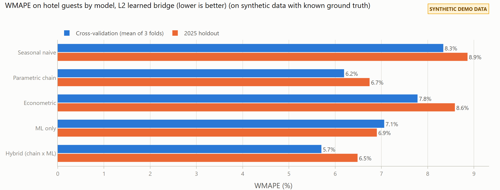
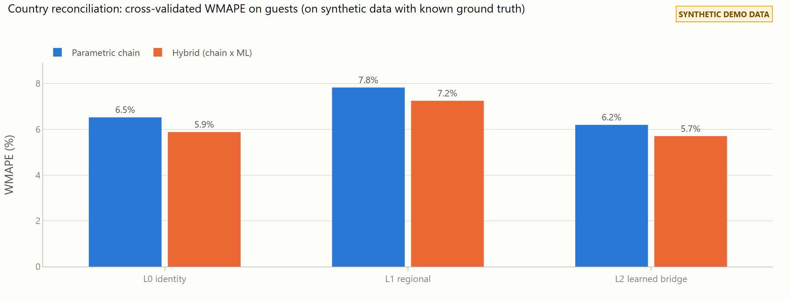
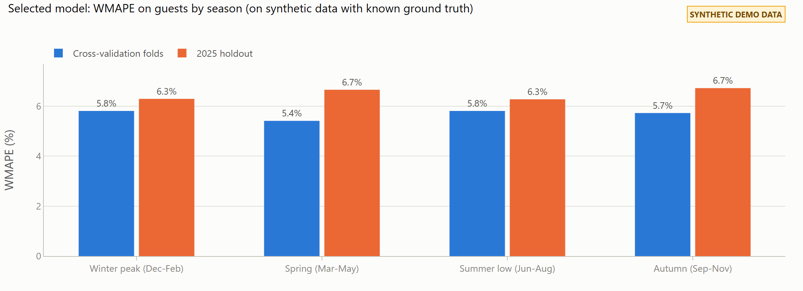
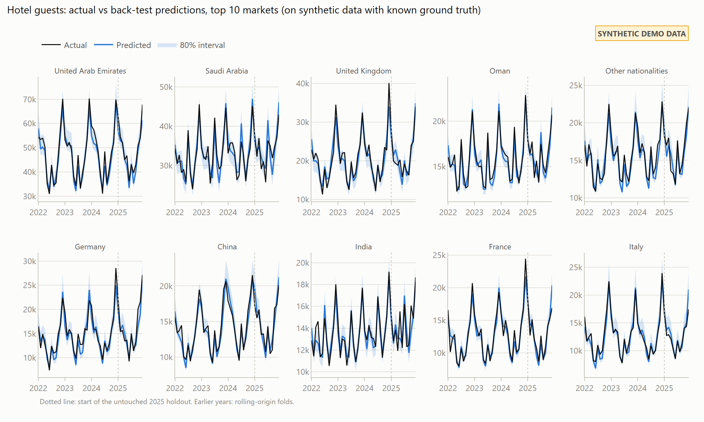
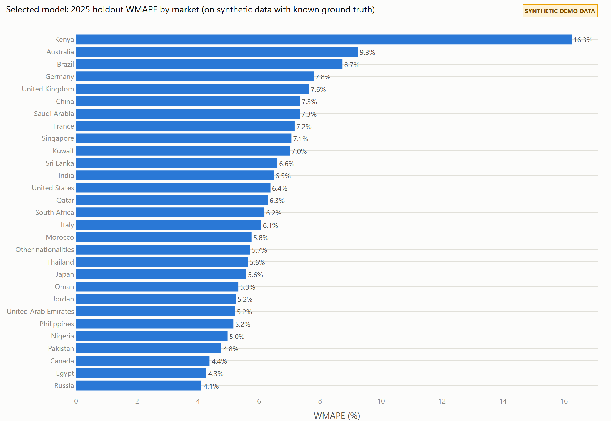

# Back-test results (on synthetic data with known ground truth)

> **SYNTHETIC DEMO DATA.** Every number below measures how well the method reproduces a synthetic world with known ground truth. None of it is a claim about real Abu Dhabi accuracy.

## Set-up

- Target: monthly hotel guests (and guest nights) by nationality (29 markets).
- At forecast time the model sees: flight schedule (seats) for the test months, event and holiday calendars; load factor, transfer share and all conversion parameters estimated on training months only.
- Rolling-origin folds with an expanding window and a 12-month horizon; everything is refit per fold on months before the cutoff (enforced by `tests/test_leakage.py`).

| Fold | Training months | Test window |
| :- | -: | :- |
| fold1 | 36 | 2022-01 to 2022-12 |
| fold2 | 48 | 2023-01 to 2023-12 |
| fold3 | 60 | 2024-01 to 2024-12 |
| holdout (final holdout, scored once) | 72 | 2025-01 to 2025-12 |

## Selected model

**L2 learned bridge + Hybrid (chain x ML)**, chosen by lowest mean CV WMAPE on hotel guests (5.7%).

## WMAPE against every baseline (L2 learned bridge)

| Model | CV WMAPE guests | CV WMAPE nights | CV bias | CV MASE | Holdout WMAPE guests | Holdout WMAPE nights | Holdout bias |
| :- | -: | -: | -: | -: | -: | -: | -: |
| Seasonal naive | 8.3% | 9.3% | -3.8% | 1.39 | 8.9% | 9.6% | -1.8% |
| Parametric chain | 6.2% | 7.0% | -2.3% | 0.96 | 6.7% | 7.0% | -2.0% |
| Econometric | 7.8% | 8.4% | -2.8% | 1.19 | 8.6% | 8.8% | -4.6% |
| ML only | 7.1% | 7.8% | -1.2% | 1.05 | 6.9% | 7.3% | 0.8% |
| Hybrid (chain x ML) | 5.7% | 6.5% | -1.1% | 0.93 | 6.5% | 6.9% | -1.1% |

## Country reconciliation (origin country vs guest nationality)

| Level | Parametric CV WMAPE | Hybrid CV WMAPE | Parametric holdout | Hybrid holdout |
| :- | -: | -: | -: | -: |
| L0 identity | 6.5% | 5.9% | 6.9% | 6.6% |
| L1 regional | 7.8% | 7.2% | 8.8% | 7.1% |
| L2 learned bridge | 6.2% | 5.7% | 6.7% | 6.5% |

Best level for the transparent chain alone: **L2 learned bridge**.

## Errors by season (selected model)

| Season | CV WMAPE | Holdout WMAPE | Holdout bias |
| :- | -: | -: | -: |
| Winter peak (Dec-Feb) | 5.8% | 6.3% | 0.4% |
| Spring (Mar-May) | 5.4% | 6.7% | -0.5% |
| Summer low (Jun-Aug) | 5.8% | 6.3% | 0.1% |
| Autumn (Sep-Nov) | 5.7% | 6.7% | -4.2% |

## Prediction intervals (split-conformal)

Calibrated on out-of-fold residuals from the three rolling folds (per market where it has >= 30 residuals, otherwise pooled by region), then checked once on the 2025 holdout.

| Quantity | Nominal 80% | Empirical 80% | Nominal 95% | Empirical 95% |
| :- | -: | -: | -: | -: |
| guests | 80% | 79% | 95% | 91% |
| nights | 80% | 81% | 95% | 93% |

## The five worst markets (2025 holdout) and why

| Market | WMAPE | Bias | Share of guests | Explanation |
| :- | -: | -: | -: | :- |
| Kenya (KE) | 16.3% | -4.9% | 1.3% | route history is short or interrupted (served 2022-10 to 2025-12) |
| Australia (AU) | 9.3% | 2.2% | 3.9% | no structural cause identified; error is within normal month-to-month noise |
| Brazil (BR) | 8.7% | -1.1% | 1.0% | small market (1.0% of guests), so modest absolute errors are large in % terms; route history is short or interrupted (served 2021-07 to 2025-12); hotel data missing for 2023-11 |
| Germany (DE) | 7.8% | -3.9% | 5.2% | systematic under-prediction (bias -3.9%) |
| United Kingdom (GB) | 7.6% | 0.5% | 6.7% | no structural cause identified; error is within normal month-to-month noise |

